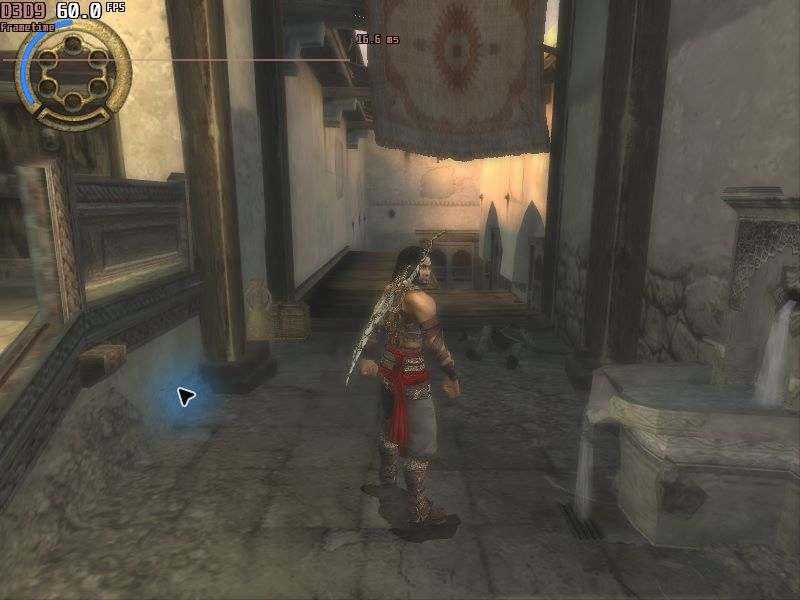

# Warrior Within Prince — Model, Water Sword & Voice

**0.5.0 · One JTMod for Steam and OpenJade 0.4.1 · by beatsdtx06**

The Warrior Within Prince model, Water Sword from New Game, and approved **93-line English Prince voice preview** for The Two Thrones, together in exactly one `.jtmod` download. The AI-converted voice retains TTT dialogue and timing; it is not a new recording by the original actor.

**[Download the single universal JTMod](https://github.com/beatsdtx06/ww-prince-water-sword/releases/download/v0.5.0/WW-Prince-Model-Sword-Voice-0.5.0.jtmod)**

The **same file** is used for both editions. No separate voice download, ZIP extraction, AI service, API key, Python, GPU or model download is required by players.

## Included behavior

| Edition | Model and Water Sword | Voice |
| --- | --- | --- |
| Steam | WW Prince, hair and medallion; Water Sword from New Game; normal damage/story behavior | Approved 93 converted spoken lines |
| OpenJade 0.4.1 | Same WW Prince; persistent Water Sword; **enhanced damage and boss-only blue aura retained** | Identical approved 93 lines |

The package preserves each edition's accepted 0.4.0 archive result. OpenJade-only effects are selected by the included setup helper, not forced onto the Steam engine.

**Voice coverage is partial:** 17 held spoken lines, 13 ambiguous/nonverbal records, mixed cinematics, the Dark Prince and other characters remain original. Converted clips total about 7 minutes 53 seconds. [Coverage details](docs/VOICE-COVERAGE.md).

## Install

Requirements: a legally obtained supported PC game, its supported **English** sound bank, Windows PowerShell 5.1, and [PoP Mod Manager](https://github.com/kaminoer/PoP-Mod-Manager) **2.1.2 or newer with JTMod v9 support**. OpenJade requires the separately installed 0.4.1 engine. Allow at least **2 GB free** for temporary files/backups, plus Mod Manager's own archive space. Back up saves.

1. Restore/remove the old separate WW Prince/Water Sword packages through Mod Manager. Use the supported clean base; do not stack this with old editions or overlapping mods. An existing exact approved voice preview can stay installed.
2. Import **`WW-Prince-Model-Sword-Voice-0.5.0.jtmod`** and apply it to the intended Steam or OpenJade game folder. **Steam only:** enable **Large assets** in Mod Manager.
3. Close the game and Mod Manager. Open the game's newly added **`WWPrince-Model-Sword-Voice`** folder and double-click **`Finish-Setup.cmd`**. Type **Steam** or **OpenJade** when asked. It automatically uses the parent game folder.
4. Run **`Manage-Mod.cmd`**, choose **Check**, then the same edition. It should report all three components matching. Launch the game and test a New Game.

**Finish Setup is required.** Mod Manager installs the common model/sword and places all necessary setup/voice/effect files inside the game folder; it does not execute scripts. Finish Setup installs the voice and either the Steam interpreter fix or OpenJade's full effects. Import/apply alone is not a complete installation.

## What's inside the single file

- Native model/sword record patches for `pop3.bf`.
- `WWPrince-Model-Sword-Voice/Finish-Setup.cmd`, `Manage-Mod.cmd`, `Manage-Mod.ps1` — installation, checking and restoration.
- `installers/Install-Steam-Water-Sword.ps1` — reversible, exact-hash-guarded Steam fix.
- `installers/Manage-OpenJade-Effects.ps1` and `openjade-effects.delta.gz` — reversible OpenJade enhanced-damage/blue-aura delta; no complete game archive.
- `voice/Manage-Voice.ps1`, `voice/manifest.json`, and **all 93** `voice/patches/*.bin` payloads.
- `package-manifest.json`, README, changelog, notices, documentation and reference screenshot. The manifest lists every required setup file and its SHA-256 hash.

Keep this generated setup folder intact. **Do not download individual repository source files to install.** The repository's `tools/`, `source/` and `BUILD.md` are development material, not extra player downloads. No full game/sound archive, executable, engine DLL, AI weights, API credentials, raw voice dataset or private backup is distributed.

## Restore / uninstall

1. Close the game and Mod Manager.
2. Run the generated `Manage-Mod.cmd`, choose **Restore**, then the correct edition. This restores voice and the edition-specific interpreter/effects changes, retaining verified backups.
3. Only then use **Restore original** in Mod Manager to remove the common model/sword and generated files. On Steam, disable **Large assets** too.

Always restore with the helper **before** Mod Manager removes its files or before changing the mod selection. OpenJade's helper changes `pop3.bf` after Mod Manager applies it; a manager integrity warning before helper restoration is expected. Do not force reapply over this state. See [installation and recovery](docs/INSTALLATION.md).

## Verification and limits

Exact supported and output hashes are in [compatibility](docs/COMPATIBILITY.md). The combined package is checked by extracted-file tests on disposable real-archive copies, byte-exact edition output/restore comparisons, and installer safety tests; see [test scope](docs/TESTS.md). Existing accepted model/sword and voice bytes are preserved. A fresh full campaign and playback of every converted line are **not** verified.

Unofficial fan mod; no Ubisoft or voice-actor endorsement. See [notices](NOTICES.md).

